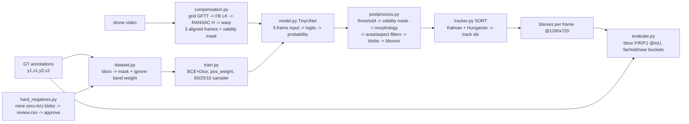

# motion-detect — aerial moving-target detection from drone video

Detecting small moving objects (e.g. other drones) in footage from a moving
camera is hard because camera motion dominates frame-to-frame differences.
This project detects moving targets **without any pre-trained detector**: a
classical pipeline compensates camera motion (grid GFTT → forward/backward
Lucas-Kanade → RANSAC homography → warp), a tiny 3-frame U-Net scores motion
probability on the compensated frames, connected components become candidate
blobs, and a SORT tracker (Kalman filter + Hungarian assignment) produces
stable bounding boxes. The U-Net is trained on masks rasterized from
**ground-truth bounding boxes** (not pseudo-labels), with a manual-reviewed
hard-negative mining loop to suppress systematic false positives such as the
platform/rotor region.



## Install

```bash
python -m venv .venv && source .venv/bin/activate   # Windows: .venv\Scripts\activate
pip install -r requirements.txt
pip install -e .          # optional, puts motion_detect on the path
pip install pytest        # for tests
# optional, macOS only: pip install coremltools   (Core ML export/prediction)
```

Run tests (CPU, synthetic inputs only, no data needed):

```bash
PYTHONPATH=src python -m pytest tests/ -q
```

## Configuration and dataset layout

All paths come from YAML, never from hard-coded Colab paths:

```bash
cp configs/paths.example.yaml configs/paths.yaml   # then edit the paths
```

```
paths.yaml            -> videos_dir, annotations_dir, dataset_root, checkpoints_dir, results_dir
configs/default.yaml  -> processing/compensation, detection, training, mining, calibration, evaluation
```

Expected raw data layout (folders or ZIP archives, see `extract_archives`):

```
Videos/            Clip_01.mov ... Clip_50.mov
Video_Annotation/  *_gt.txt   lines: "time_layer: N objects: (y1, x1, y2, x2) ..."
dataset_root/
  train/ val/      generated samples:
    frames/  <sid>_t2.png, <sid>_t1.png, <sid>_t0.png
    masks/   <sid>_mask.png        (255 inside GT bbox)
    weights/ <sid>_weight.png      (0 = ignore-band excluded from BCE)
    bboxes/  <sid>.npy             (processing coords, x1,y1,x2,y2)
    bboxes_src/ <sid>.npy          (source coords)
    groups/  <sid>.txt             ("hard_negative" only for mined samples)
```

Clip split (seed 42, clips 1–50): 35 train / 5 val / 10 test.
The evaluation clip sets used in the notebooks are `val_clips: [3, 28, 38, 48, 50]`
and `test_clips: [2, 6, 7, 8, 9, 15, 16, 18, 35, 41]` (see `configs/default.yaml`).

## Running the stages

```bash
# 1. Generate the dataset (GT-bbox masks, production compensation pipeline)
python scripts/make_dataset.py --config configs/paths.yaml --defaults configs/default.yaml

# 2. Mine hard negatives -> review -> approve
python scripts/mine_hard_negatives.py mine    --config configs/paths.yaml --checkpoint checkpoints/best_unet.pth --round 1
#    inspect results/hard_negative_staging/round_01/review_grids/*.jpg,
#    fill decision=approve/reject in round_01/review.csv (schema below), then:
python scripts/mine_hard_negatives.py approve --config configs/paths.yaml --round 1

# 3. Train (checkpoint format: epoch/model/val_f1/... exactly as in the notebooks)
python scripts/train.py --config configs/paths.yaml --checkpoint-dir checkpoints

# 4. Evaluate (bbox P/R/F1 with IoU matching, far/mid/near buckets, threshold sweep)
python scripts/evaluate.py --config configs/paths.yaml --checkpoint checkpoints/best_unet.pth \
    --clips 3,28,38,48,50 --thresholds 0.60,0.65,0.70,0.75,0.80,0.85,0.90,0.95 \
    --report results/eval_val.json

# 5. Inference on one clip -> annotated mp4 + JSON bboxes
python scripts/infer_video.py --config configs/paths.yaml --checkpoint checkpoints/best_unet.pth \
    --clip 41 --output results/render/Clip_41_annotated.mp4
#    (add --pipelined for the 2-thread producer/consumer variant)

# 6. Calibrate post-processing on cached probability maps
python scripts/calibrate.py --config configs/paths.yaml --checkpoint checkpoints/best_unet.pth \
    --report results/calibration/postprocess_calibration.json
```

Hard-negative review CSV schema (data-free, written by mining, filled by a human):
`rank, sample_id, decision, notes, score, rank_score, prob_max, area, inlier_ratio, clip_id, frame_index, rotor_zone_hit, rotor_zone_overlap_area_1280`
with `decision ∈ {approve, reject}`; ranks 1..200 must each appear exactly once
(strict validation in `read_review_decisions`). Round 01 approved 57 / rejected 143.

Optional Core ML export (macOS for prediction; conversion can run anywhere with coremltools):
see `src/motion_detect/export_coreml.py` (`export_tinyunet_coreml_fp16`, FP16 ML Program).

A thin end-to-end demo lives in `notebooks/demo.ipynb`.

## Results (from notebook outputs only)

All numbers below are copied from the research notebook outputs
(`docs/reports/*.json`); nothing is re-computed here. **The rows use different
models and/or clip sets and are not directly comparable.**

| Metric definition | Model / checkpoint | Clip set | Threshold | P | R | F1 |
|---|---|---|---|---|---|---|
| Pixel val F1 @ prob 0.5 (masks from GT bboxes) | baseline, epoch 23 | val split (300 samples) | 0.5 | — | — | **0.681** |
| Pixel val F1 @ prob 0.5 | hard-negative round 01, epoch 25 | val split (300 samples) | 0.5 | — | — | **0.623** |
| Bbox P/R/F1, Hungarian matching, IoU 0.20, 1280x720 coords | baseline, epoch 23 | val clips [3,28,38,48,50] | 0.95 | **0.836** | **0.716** | **0.772** |
| Bbox P/R/F1, IoU 0.20, production settings (platform suppression off) | hard-negative round 01, epoch 25 | test clips [2,6,7,8,9,15,16,18,35,41] | 0.95 | **0.315** | **0.191** | **0.238** |

The full val bbox threshold sweep (baseline model, val clips) is in
`docs/reports/val_bbox_threshold_sweep.json`: F1 rises monotonically from
0.644 @ 0.60 to 0.772 @ 0.95.

### Known limitations

- **Threshold 0.95 sits at the edge of the sweep grid** — F1 was still rising
  at 0.95, so the optimum was not bracketed; the true val optimum may be higher.
- **Large gap between val and test results** (bbox F1 0.772 on val clips vs
  0.238 on test clips with the hard-negative model): the test clips are harder
  and the two rows also use different models, so the gap is not a clean
  ablation.
- **Hard negatives lowered pixel val F1** (0.681 → 0.623) while being intended
  to improve precision; the object-level effect was only measured on the test
  clips with platform suppression toggled (P 0.313→0.315, F1 0.235→0.238).
- Size buckets on the test set (hard-negative model): far targets are
  essentially undetected (far: TP 0 / FN 0 — no GT objects in that bucket on
  those clips; mid: recall 0.0012; near: P 0.315 / R 0.215).

### TODO

- F1 0.872 from CV — source report not found; do not publish until a reproducible report exists.

## Data & checkpoints

Neither the dataset nor the trained weights are included in this repository
(see `.gitignore`: `data/`, `checkpoints/`, `*.pth`, `*.zip`, `*.mov`).
Point `configs/paths.yaml` at your own copies:

```
Videos/             Clip_01.mov ... Clip_50.mov   (or a ZIP with the same layout)
Video_Annotation/   Clip_01_gt.txt ...             (or a ZIP)
checkpoints/        best_unet.pth                  (not included)
data/dataset_gt/    train/ val/                    (generated by scripts/make_dataset.py)
```

GT annotation line format (one line per annotated frame, 1-based frame ids;
coordinates are `(y1, x1, y2, x2)` in source-video pixels and are converted
to `(x1, y1, x2, y2)` internally by `parse_gt_file`):

```
time_layer: 5 detections: (100.0, 200.0, 112.0, 224.0) (y1,x1,y2,x2) ...
```

A frame with no detections is written as `time_layer: N detections:` (empty
list = valid negative frame).

## Reproducing numbers

With `configs/paths.yaml` pointing at your data and the checkpoints in place:

```bash
# Val bbox sweep / single point — baseline model, val clips, IoU 0.20, thr 0.95
python scripts/evaluate.py --config configs/paths.yaml --defaults configs/default.yaml \
    --checkpoint checkpoints/best_unet.pth \
    --clips 3,28,38,48,50 --iou 0.20 --thresholds 0.95 \
    --report results/eval_val_thr095.json
# full sweep: --thresholds 0.60,0.65,0.70,0.75,0.80,0.85,0.90,0.95

# Test clips — hard-negative round-01 model (production settings), IoU 0.20, thr 0.95
python scripts/evaluate.py --config configs/paths.yaml --defaults configs/default.yaml \
    --checkpoint checkpoints/hard_negative_round01_*/best_unet.pth \
    --clips 2,6,7,8,9,15,16,18,35,41 --iou 0.20 --thresholds 0.95 \
    --report results/eval_test_thr095.json
```

Expected (from the notebook outputs, `docs/reports/`): val @0.95 →
P 0.8361 / R 0.7165 / F1 0.7717; test @0.95 (platform suppression off) →
P 0.3150 / R 0.1906 / F1 0.2375. Exact reproduction also requires the same
compensation config (`configs/default.yaml`) and `compensation_step: 1`.

## Repository layout

```
motion-detect/
├── configs/            default.yaml (all tunables), paths.example.yaml (your paths)
├── src/motion_detect/  compensation, model, dataset, train, hard_negatives,
│                       postprocess, tracker, inference, evaluate, calibration,
│                       export_coreml (optional), utils, config
├── scripts/            make_dataset, train, mine_hard_negatives, evaluate, infer_video, calibrate
├── tests/              pytest, CPU-only, synthetic inputs
├── notebooks/demo.ipynb
├── docs/reports/       JSON reports copied from the notebook outputs
└── assets/             placeholder for a demo gif
```
